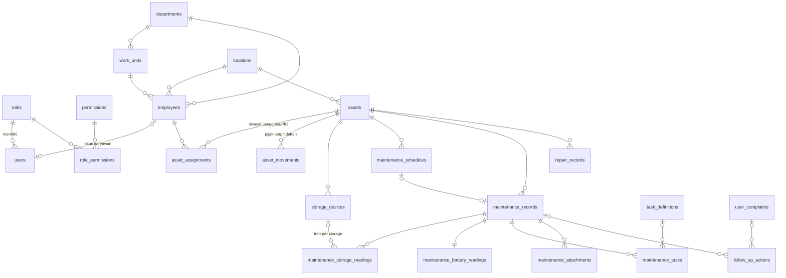

# Tahap 1 — Analisis Kebutuhan, Arsitektur & Rancangan Database

## 1. Ringkasan kebutuhan

| Kebutuhan (master prompt) | Implementasi |
|---|---|
| Inventaris PC/laptop/workstation | Modul **Master Aset PC** (`/assets`): CRUD, foto, storage terpasang, impor/ekspor xlsx/csv, soft delete |
| Suhu CPU/SSD/HDD, health SSD/HDD, baterai | Form maintenance: kartu SSD (hijau), HDD (biru), baterai (oranye); multi-storage; NULL = tidak diperiksa |
| Perawatan fisik (fan, thermal paste, dst.) | Checklist 3 status per item (Sudah / Tidak diperlukan / Belum), tanpa default "selesai"; item dapat dikonfigurasi admin |
| Pengguna, departemen, unit kerja, lokasi, PIC | Modul **Pengguna PC & Unit Kerja** (`/employees`, `/org`), penugasan pengguna utama + PIC unit |
| Riwayat maintenance & histori aset | Snapshot identitas pada setiap record; `asset_assignments` & `asset_movements` append-only; detail aset 10 tab |
| Identifikasi perangkat bermasalah | Mesin evaluasi berbasis threshold yang dapat dikonfigurasi; dashboard "Perangkat yang membutuhkan tindakan IT" |
| Jadwal maintenance | Interval per jenis perangkat + override per aset, jadwal otomatis, pengingat, terlambat, penugasan teknisi |
| Laporan | 7 jenis laporan, filter lengkap, ekspor PDF/Excel/CSV, laporan resmi per maintenance dengan tanda tangan |
| Dokumentasi foto/PDF | Upload aman (magic bytes, ukuran, nama acak, di luar folder publik, akses via route berizin) |
| Hak akses 4 role | RBAC berbasis tabel `permissions` + `role_permissions`, diperiksa di setiap endpoint |

## 2. Keputusan teknologi

Master prompt memprioritaskan PHP (CodeIgniter 4/Laravel) namun mengizinkan framework lain dengan alasan. **Stack dipilih bersama pengguna: Node.js + Express + PostgreSQL**, dengan alasan:

1. **Satu bahasa (JavaScript) di frontend & backend** — tim IT cukup menguasai satu bahasa untuk pengembangan lanjutan dan integrasi API.
2. **PostgreSQL lokal yang andal** — database relasional penuh fitur; Node.js + PostgreSQL berjalan berdampingan di Windows (lihat `INSTALL-WINDOWS.md`).
3. **Dependensi kecil & stabil** — Express 5, pg (prepared statement), EJS (escape otomatis), Bootstrap 5, Chart.js, PDFKit, ExcelJS. Semua aset frontend dibundel lokal: aplikasi tetap berjalan di intranet tanpa internet.
4. **Mudah diuji** — test otomatis `node:test` + supertest terhadap database PostgreSQL sungguhan.

Komponen setara dengan permintaan: Bootstrap 5 ✔, Chart.js ✔, library PDF (PDFKit) ✔, Excel (ExcelJS ≈ PhpSpreadsheet) ✔, session aman (express-session + store PostgreSQL) ✔, konfigurasi via `.env` ✔.

## 3. Arsitektur

```
Browser (Bootstrap 5, JS tanpa inline script, CSP ketat)
   │  HTTPS (reverse proxy Nginx/IIS disarankan)
   ▼
Express 5 ── helmet (CSP, header) ── session (MySQL store) ── CSRF ── loadUser + RBAC
   │
   ├─ routes/            HTTP: validasi input, cek izin, render EJS / JSON
   ├─ services/          logika bisnis: maintenance (transaksi), evaluation, assignments,
   │                     uploads, reports, exporter (PDF/XLSX/CSV), printing, audit
   ├─ views/             EJS (escape default) + partials
   └─ config/            env, pool DB, daftar permission, menu
   ▼
MySQL / MariaDB (InnoDB, utf8mb4, FK, indeks)         storage/uploads (di luar /public)
```

Pola penting:
- **Semua query memakai placeholder** (`?`) → aman dari SQL injection; kolom sorting hanya dari whitelist.
- **Penyimpanan maintenance dalam satu transaksi**: record + pembacaan storage + baterai + checklist + lampiran + jadwal + tindak lanjut + audit. Bila gagal, transaksi di-rollback dan file yang sudah dipindahkan dihapus.
- **Form progresif**: form dikirim via `fetch` (JSON), tetapi tetap berfungsi tanpa JavaScript (redirect + flash).

## 4. Struktur folder

```
pm-it-asset/
├── database/
│   ├── migrations/        001_core_schema.sql, 002_sessions.sql
│   ├── migrate.js         runner migrasi (schema_migrations)
│   ├── seed.js            data dasar wajib (role, izin, admin, threshold, interval, checklist)
│   └── demo.js            data demonstrasi (dapat dihapus tuntas)
├── docs/                  dokumentasi
├── public/                css, js, img (statis)
├── scripts/               backup.js, restore.js
├── src/
│   ├── app.js, server.js
│   ├── config/            index.js (env), db.js, permissions.js, menu.js
│   ├── middleware/        auth.js (login, RBAC), security.js (CSRF, idle), respond.js (error, flash)
│   ├── routes/            auth, dashboard, assets, employees, org, maintenance, schedules,
│   │                      followups, complaints, reports, admin, api, files
│   ├── services/          maintenance, evaluation, assignments, assets, uploads, exporter,
│   │                      printing, reports, settings, notifications, audit
│   ├── utils/             validate.js, helpers.js, logger.js
│   └── views/             EJS per modul + partials
├── storage/               uploads/ & backups/ (dibuat otomatis, jangan dipublikasikan)
└── tests/                 test otomatis
```

## 5. Rancangan database

Seluruh tabel wajib tersedia (`users, roles, departments, work_units, locations, employees, assets, asset_assignments, storage_devices, maintenance_schedules, maintenance_records, maintenance_storage_readings, maintenance_battery_readings, maintenance_tasks, maintenance_attachments, repair_records, follow_up_actions, hardware_thresholds, audit_logs`), ditambah tabel pendukung: `permissions, role_permissions, asset_movements, maintenance_intervals, task_definitions, app_settings, number_sequences, user_complaints, agent_tokens, agent_readings, demo_registry, sessions, schema_migrations`.



Prinsip data:
- **NULL = tidak berlaku / tidak diperiksa / tidak tersedia.** Contoh: "Tidak Ada HDD" → tidak ada baris HDD; desktop → `maintenance_battery_readings.is_applicable = 0` dan semua nilai NULL; sensor CPU tidak terbaca → `cpu_temp_c = NULL`. Tidak ada nilai 0 pengganti.
- **Riwayat tidak berubah saat perpindahan**: `maintenance_records` menyimpan snapshot (kode aset, hostname, pengguna, NIK, departemen, unit, lokasi, ruangan). `asset_assignments` menutup baris lama (`end_date`, `is_current = 0`) dan membuat baris baru.
- **Soft delete** (`deleted_at`) untuk aset, karyawan, akun, maintenance, jadwal, lampiran, tindak lanjut, perbaikan.
- **Timestamp** `created_at` / `updated_at` di setiap tabel; indeks pada kolom pencarian & filter.
- **Nomor maintenance otomatis** `PM-YYYYMM-0001` dari `number_sequences` (aman dari balapan karena `LAST_INSERT_ID` di dalam transaksi).
- **Sumber data**: kolom `data_source` (MANUAL/AGENT) dan `read_at` pada CPU, storage, baterai; record berisi `MANUAL/AGENT/CAMPURAN`.

## 6. Aturan evaluasi kondisi hardware

Implementasi: `src/services/evaluation.js` (diuji di `tests/01-evaluation.test.js`).

1. Untuk setiap parameter yang **benar-benar diperiksa** (suhu CPU, suhu & health SSD/HDD, SMART, battery health, kondisi fisik, penilaian teknisi), sistem memilih **threshold aktif paling spesifik** dari `hardware_thresholds` (pola model > merek > antarmuka > jenis perangkat > umum).
2. Suhu: Perhatian bila ≥ batas perhatian, Kritis bila ≥ batas kritis. Health: Perhatian bila ≤ batas perhatian, Kritis bila < batas kritis (sesuai contoh kebijakan: >90 baik, 70–90 pantau, <70 evaluasi penggantian).
3. **SMART Kritis → Kritis walaupun health tinggi.** SMART "Tidak Tersedia" ditampilkan apa adanya dan (default) diperlakukan *Perlu Perhatian*; dapat diubah admin menjadi *Informasi*. Tidak pernah otomatis "Baik".
4. Status akhir = **level terburuk** dari seluruh parameter yang dievaluasi — tidak pernah dari satu parameter saja.
5. Penandaan tambahan: penurunan health/baterai atau kenaikan suhu signifikan dibanding pemeriksaan sebelumnya (ambang di Pengaturan Sistem), dan peringatan bila penilaian teknisi lebih baik daripada hasil parameter.
6. Hasil Perhatian/Kritis → konfirmasi di form, tindak lanjut otomatis berprioritas, persetujuan Manager IT (sesuai mode), dan **jadwal berikutnya dipersingkat** (default maks. 30 hari untuk Perhatian, 7 hari untuk Kritis).
7. Threshold awal hanyalah **contoh kebijakan** — wajib ditinjau admin sesuai datasheet produsen.

## 7. Matriks hak akses default

Sistem hanya dipakai tim IT. Pengguna PC/karyawan **tidak memiliki akun**; mereka cukup dicatat di menu Pengguna PC.

| Kemampuan | Administrator | Manager IT | Staff IT |
|---|:-:|:-:|:-:|
| Dashboard, laporan, ekspor | ✔ | ✔ | ✔ |
| Tambah/ubah aset (termasuk daftar perangkat baru dari form maintenance) | ✔ | lihat | ✔ |
| Hapus & impor aset | ✔ | – | – |
| Kelola pengguna PC & penugasan | ✔ | lihat | ✔ |
| Kelola master unit kerja | ✔ | lihat | lihat |
| Isi/ubah maintenance, unggah dokumentasi | ✔ | – | ✔ |
| Ubah maintenance yang sudah Selesai | ✔ | – | – |
| Setujui hasil maintenance | ✔ | ✔ | – |
| Kelola jadwal & tindak lanjut | ✔ | ✔ | ✔ |
| Audit log | ✔ | ✔ | – |
| Threshold, pengaturan, akun, role | ✔ | – | – |

*Admin dapat mengubah matriks untuk role lain di menu **Role & Hak Akses**; role Administrator selalu penuh agar tidak terkunci dari sistem.

> Catatan: fitur Agent Hardware (pembacaan otomatis) telah dihapus atas permintaan pengguna; seluruh data pemeriksaan diisi manual melalui form. Tabel `agent_tokens`/`agent_readings` dibiarkan di database tetapi tidak dipakai.
